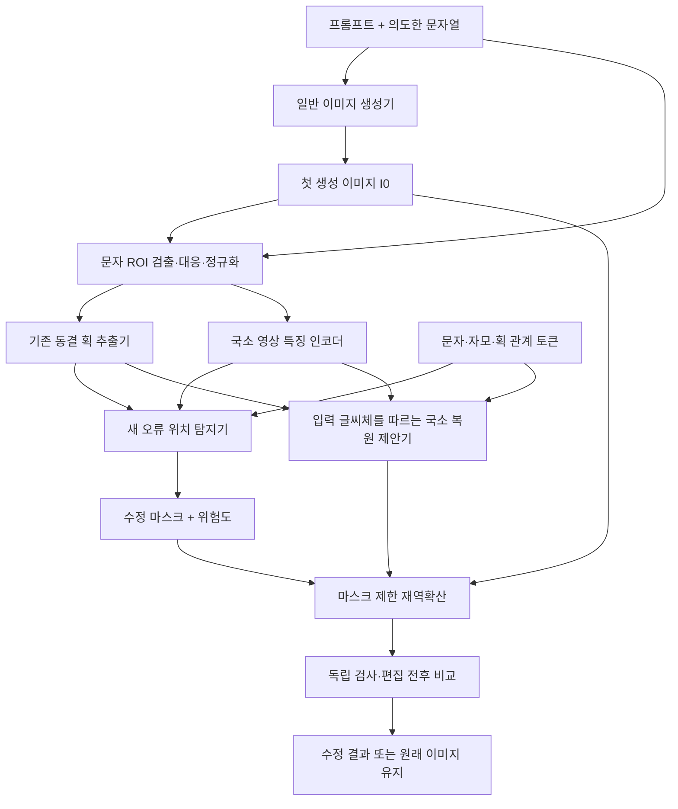

# 생성 한글의 오류 위치 탐지와 국소 재보정: 모델 설계 v1

작성: 2026-11-09. 상태: 설계 및 초기 모델 구조·손실 구현 완료. 학습·성능 검증·확산 연결 전이다. 기존 노트북의 하이퍼파라미터만 변경하는 안이 아니다.

## 1. 목표와 문제 정의

입력은 (1) 프롬프트로 일반 생성기가 만든 이미지 I0, (2) 의도한 문자열 y, (3) 문자 영역 및 문자열과의 대응이다. 테스트 시 같은 글씨체의 깨끗한 정답 이미지, 생성 전의 폰트 이미지, 정답 오류 마스크는 주지 않는다. 출력은 정상 글씨체와 배경을 유지하면서 특정 구조 오류를 수정한 이미지 I1 및 편집 위치/신뢰도다.

폰트를 미리 그려 img2img에 넣는 경로는 통제된 진단용 대조군으로만 남긴다. 실제 역할 검증은 별도의 text-to-image 생성물에서 시작한다. 이미지 생성기는 교체 가능하며 보정 모듈의 효과를 생성기의 성능과 구분한다.

첫 버전 범위는 정상 글자에 붙은 추가 가지와 떨어진 잡획이다. 목표 사례는 가의 ㅏ에서 세로획 왼쪽으로 이어진 잉크를 제거하되 세로획·오른쪽 가로획·명조 세리프는 유지하는 것이다. 누락/끊김 복원, 완전히 틀린 문자 재생성, 문장 전체 레이아웃 교정은 후속 범위다. 읽을 수 없는 가짜 글자 전체를 작은 국소 오류로 취급하지 않는다.

문자 정체성은 이미지 자체만으로 결정할 수 없다. 정상적인 아와 야를 구분하려면 의도한 문자열이 필요하다. 따라서 '현재 이미지에서 오류 감소'는 '입력 이미지와 의도한 문자에 근거한 판단'이며 무조건적인 참조 없는 판단을 뜻하지 않는다.

## 2. 현재 실패에서 확인한 점

- 정답 RGB로 만든 삭제 지도는 역확산에서 잉크 제거를 유도했다. 이는 정확한 수정 위치를 알려줄 때의 편집 가능성을 보인 oracle 대조군이다.
- 정규화한 방향/모멘트/접촉 위치의 평균 오차는 명조 세리프를 깎아도 감소했다. scalar loss 감소를 구조 개선으로 해석하면 안 된다.
- V2의 softmax와 masks=image*probabilities는 모든 잉크를 어떤 획에 배정한다. '소속 획'과 '그 잉크가 필요한가'는 별도 문제다.
- 20261109 두 단계 ZIP에서 가이드는 15회 반영됐고, 구조 손실은 재역확산만 한 경우 0.08980에서 0.06662로 감소했지만 가의 손실 감소는 약 2.8%이며 부착 돌출이 남았다. 전체 수치 개선은 다른 문자에 집중됐다.
- 첫 생성물 전체에 대한 보존 손실은 정상 영역과 오류 영역을 구별하지 않는다. 잡음을 다시 넣는 것만으로 오류 판단 지표가 개선되지는 않는다.

## 3. 선행 연구 검토와 적용 경계

아래의 '우리 적용'은 논문의 검증 결과가 아니라 이 프로젝트의 설계 선택이다. 어떤 논문도 현재 체크포인트의 한글 부착 돌출 제거를 보장하지 않는다.

| 연구 | 확인한 원리 | 우리 적용 | 그대로 가져오지 않는 점 |
|---|---|---|---|
| [DRAEM, ICCV 2021](https://openaccess.thecvf.com/content/ICCV2021/html/Zavrtanik_DRAEM_-_A_Discriminatively_Trained_Reconstruction_Embedding_for_Surface_Anomaly_ICCV_2021_paper.html) | 정상 영상에 이상을 합성해 복원과 판별을 함께 학습하고 이상 위치를 직접 예측 | 합성한 획 오류의 실제 변경 위치로 오류 지도 감독 | 표면 질감 이상과 문자의 의미적 오류는 다르다. Perlin 질감만으로 학습하지 않으며 DRAEM 전체 재현도 아니다 |
| [SDEdit](https://arxiv.org/abs/2108.01073) | 입력에 잡음을 넣고 재확산해 편집 | 첫 생성물을 작은 잡음으로 재보정하는 바깥 흐름 | 자동 오류 탐지나 정확한 한글 복원 능력을 제공하지 않는다 |
| [RePaint, CVPR 2022](https://arxiv.org/abs/2201.09865) | 알려진 영역을 이용해 역확산을 조건화하는 마스크 기반 인페인팅 | 오류 마스크 밖은 관측된 생성물을 유지하고 내부만 복원 | 픽셀 DDPM의 샘플링을 latent DDIM에 옮기면 같은 알고리즘이 아니다. 얇은 획에서 VAE 공간적 번짐을 별도 검사 |
| [clDice, CVPR 2021](https://openaccess.thecvf.com/content/CVPR2021/html/Shit_clDice_-_A_Novel_Topology-Preserving_Loss_Function_for_Tubular_Structure_CVPR_2021_paper.html) | 마스크와 중심선 관계로 연결성 감독 | 깨끗한 학습 정답이 있는 경우, 국소 복원 헤드의 연결성 보조 손실 후보 | 테스트 때 깨끗한 중심선이 없으며 획 의미·잘못된 곁가지·세리프를 이것만으로 판단할 수 없다 |
| [AnyText](https://arxiv.org/abs/2311.03054) | 문자/위치 조건과 OCR 기반 감독을 이용하는 텍스트 생성·편집 | 의미 조건과 시각 보존을 별도로 다루는 비교 기준; 독립 OCR 문자 정확도 평가 | glyph condition은 사진의 정답 RGB와 다르지만, 우리 목표에서 특정 폰트 픽셀을 맞추는 손실은 쓰지 않는다. 논문의 주요 정량 벤치마크는 중국어·영어이므로 한글 성능을 동일하게 가정하지 않는다 |
| [TextDiffuser-2](https://arxiv.org/abs/2311.16465) | 레이아웃 계획과 줄 단위 문자/위치 인코딩 | 실제 배포에서 문자열-영역 대응을 생성 단계에서 기록할 수 있다는 참고 | 현재 SD1.5에 프롬프트만 주면 정확한 네 글자가 생긴다는 근거가 아니다 |
| [DPS, ICLR 2023](https://arxiv.org/abs/2209.14687) | 관측 일치 조건을 확산 샘플링과 결합 | 외부 목적함수로 샘플링을 조절하는 참고 | 학습된 오류 확률은 알려진 물리 관측 모델이 아니다. 우리 clean-latent 수정은 DPS의 엄밀한 재현/사후확률 보장이 아니다 |

추천 조합은 'DRAEM에서 차용한 국소 이상 학습 + 기존 획 추출 특징 + 마스크 기반 국소 편집'이다. OCR과 clDice는 각각 문자 정체성/연결성 보조 역할이며 단독 성공 지표로 두지 않는다.

## 4. 전체 구조

### 4.1 문자 영역과 대응

일반 사진은 임의의 위치·원근·배경을 가진다. 고정 2×2 crop은 실제 적용의 가정으로 쓰지 않는다. 첫 구현에서는 사용자가 문자 ROI와 y와의 대응을 지정해 탐지/편집 모듈을 분리 검증한다. 다음에 OCR 검출 또는 생성기의 레이아웃 정보를 사용한다. 잘못된 글자가 OCR에서 누락되는 경우가 있으므로 OCR 결과만 믿고 정상 사례만 골라 평가하지 않는다. ROI 실패/대응 불확실은 수정 실패 또는 abstain으로 기록한다.

### 4.2 기존 획 추출기 X: 먼저 동결

현재 reference_model.py의 Swin-T, FPN, flow, 공유 획 헤드, K-way softmax를 보존한다. 추론 결과 P_k, S_k=I*P_k, 엔트로피, full-resolution 특징을 사용한다. 특징 반환은 optional return_features 인터페이스로 확장할 수 있지만 이는 아직 구현하지 않았다.

이 추출기는 기준/획 마스크를 요구한다. 따라서 v1은 문자 ID별 표준 템플릿을 획 소속 판별의 조건으로 여전히 사용할 수 있다. 이는 정확한 생성물의 정답 사진이 아니다. 새 탐지기에 템플릿 RGB를 직접 넣거나 템플릿과의 픽셀 차이를 손실로 사용하지 않는다. 표준 템플릿을 다른 폰트로 바꿔도 오류 판단이 유지되는지 별도 ablation을 한다. 이를 확인하기 전에는 템플릿 독립성을 주장하지 않는다.

추출이 틀릴 수 있으므로 P_k는 정답이 아닌 입력 특징이다. 오류 탐지기는 영상 자체도 반드시 볼 수 있어야 한다. '불필요한 잉크를 어떤 획에도 주지 않는 채널'을 기존 softmax에 임의로 추가하면 재학습이 필요하고 기존 출력 의미가 달라지므로, v1은 별도 오류 지도로 구현한다.

### 4.3 새 오류 탐지기 E: 학습이 필요한 핵심

제안 입력 해상도는 정규화 문자 crop 128×128에서 시작하고, 얇은 잔상은 256×256 분기로 보완하는 안을 비교한다. 이는 실험 후보이며 최적 해상도가 아니다.

- 영상 분기: 실제 문자 crop RGB/잉크와 gradient 등 국소 특징.
- 획 분기: 기존 FPN 특징, P_k/S_k, 획별 소속 불확실성. 공유 per-stroke 임베딩을 pooling해 가변 K를 처리한다.
- 의미 분기: 의도한 문자 및 초·중·종성 토큰, 획 유형과 상대적인 연결 관계. 원시 glyph 픽셀 목표가 아니라 '이 획이 무엇이어야 하는지'를 알려준다.
- 융합: 작은 U-Net형 다중 해상도 decoder + 문자 조건 FiLM/cross-attention. 추가 백본 전체를 처음부터 크게 학습하는 설계는 피한다.
- v1 출력: 추가 잉크 확률 E_extra(x,y), 수정 종류(부착 가지/분리 잡획), 문자별 실패 위험 점수(설계 목표; 현재 코드는 오류 존재 logit까지만 구현). 위험도는 실제 라벨과 검증셋에서 보정하고, ensemble disagreement/입력 변형 불일치도 함께 검사한다. 단순 softmax 확률을 신뢰도로 간주하지 않는다.
- 후속 출력: 누락·끊김에 대한 add 영역. v1에서 아직 학습하지 않은 누락 위치를 추정했다고 주장하지 않는다.

예: 가에서 세로획·가로획 위치를 현재 입력에서 읽고, 가로획이 붙는 쪽과 뻗는 쪽의 관계를 판단한다. 세로획의 왼쪽에 이어진 가지를 E_extra로 표시하지만, 명조체의 정상 끝장식은 clean negative로 유지해야 한다. 좌표 x=몇 픽셀 또는 고딕체 곡률을 정답으로 삼지 않는다. 관계 토큰의 정답은 사용 가능한 획 주석/벡터 정보와 작은 검수 묶음에서 만들며, 이미지 골격만으로 무조건 정확히 자동 생성된다고 가정하지 않는다.

### 4.4 국소 복원 제안기 P

오류 탐지기와 일부 영상 특징을 공유하지만 출력은 별도 RGB residual 헤드로 둔다. 현재 생성물과 문자 조건에서 수정 패치 J_hat을 예측한다. 전역 고딕체를 합성하는 목표가 아니라, 같은 글씨체·배경에서 합성 오류만 제거한 학습 쌍으로 감독한다.

v1의 단순 흑백 crop에서는 삭제 영역에 주변 배경을 복원한다. 실제 사진에서는 흰색으로 칠하지 않고 입력 주변 질감과 색으로 채워야 하므로 scene-background 학습과 별도 검증이 필요하다. 깨끗한 정답 이미지 I_clean은 학습 감독에만 있고 테스트 입력에는 없다.

## 5. 학습 자료와 라벨: 정상 폰트 차이를 오류로 만들지 않기

먼저 폰트·문자·원본 sample ID 단위로 분할하고 난 뒤 손상 변형을 만든다. 같은 원본의 서로 다른 변형이 train/test에 나뉘지 않게 한다. 폰트 파일의 다른 굵기·복제본도 가능한 한 같은 family 그룹으로 묶는다. 학습에서 본 문자/안 본 폰트, 안 본 문자/본 폰트, 둘 다 안 본 경우를 따로 보고한다.

각 정상 sample I_clean에서 I_bad를 합성하며 둘의 글씨체는 동일하다. 고딕체를 정답으로 명조체를 손상이라고 라벨링하지 않는다.

| 자료 | 만드는 방법 | 정답 및 주의 |
|---|---|---|
| 부착 추가 가지 | 실제 획 접합부에서 잘못된 쪽으로 획 연장, 휘어진 돌기, 불필요한 연결 | 실제로 새로 보이게 추가된 잉크만 delete 라벨. 원래 획과 겹쳐 원래부터 있던 픽셀은 삭제 정답이 아님 |
| 떨어진 잡획 | 점·조각·작은 가짜 글자 삽입 | 정상 점/기호/사진 요소와 구분. 텍스트 ROI 밖 객체를 자동 잡획으로 라벨링하지 않음 |
| 정상 음성 사례 | 세리프·굵기·기울기·곡선·자모 비율·약한 안티앨리어싱 차이 | no-edit. 이미 정상인 다른 폰트도 반드시 포함 |
| 문맥 대비 사례 | 아/야 등 의도한 문자에 따라 필요한 획이 달라지는 경우 | 문자 조건 없이 오류를 고르는 지름길 방지. 잘못된 문자 전체는 국소 수정 대상에서 제외/재생성 요청 |
| 실제 생성물 | 현재까지 보관한 baseline 및 추가 생성물 | 소수라도 부착 돌출/정상 세리프/불확실 영역을 사람이 주석. 합성 자료만으로 실제 오류에 일반화했다고 주장하지 않음 |

블러·압축·원근·배경 합성은 I_clean과 I_bad에 대응되게 적용한다. 라벨 support도 같은 변환을 적용하고, 불확실한 경계는 ignore/soft label로 관리한다. 기존 희소 중심선 주석의 미주석 영역을 배경/오류로 만들지 않는다. 현재 데이터의 dense 획 라벨 충실도는 구현 전에 감사해야 한다.

전체 학습의 clean/corrupt 비율·종류별 비중은 검증셋으로 선택한다. 세리프가 무조건 이상처럼 보이지 않게 폰트별·오류별 균형을 점검한다. 실사진으로 넘어갈 때는 배경/원근 조건을 추가하며, 흰 배경 합성 문자 결과를 실사진 성능으로 보고하지 않는다.

## 6. 학습 손실과 추론 손실을 구분

### 학습 시

L_train = lambda_det * L_focal(E_extra, Y_extra)
        + lambda_overlap * L_Dice(E_extra, Y_extra)
        + lambda_repair * mean_A rho(J_hat - I_clean)
        + lambda_identity * mean_(1-A) rho(J_hat - I_bad)
        + lambda_rank * L_rank
        + lambda_conn * L_connection.

A는 학습에서 알고 있는 실제 손상 영역이다. clean sample의 빈 positive map은 focal/identity 감독을 정상 처리하고, Dice가 빈 마스크에서 수치 오류를 내지 않게 정의한다. L_rank는 같은 정상 원본에서 만든 '정상 < 손상 < 더 심한 손상' 판별 순위를 감독하는 선택 항이다. L_connection은 충분한 실제 정답 마스크가 있을 때만 clDice 등으로 추가하고, sparse unknown은 제외한다. 각 lambda는 초기값을 고정 최적으로 제시하지 않고 ablation과 검증셋으로 정한다.

처음에는 기존 추출기와 생성기를 모두 동결하고 오류 탐지기를 학습한다. 탐지 성능이 검증되면 복원 헤드를 학습한다. 합동 학습은 마지막 비교 실험으로만 한다. 초기에 모든 모듈을 동시에 바꿔 원인 추적을 어렵게 만들지 않는다.

### 테스트/재역확산 시

한 번의 외부 편집 루프에서 A = stopgrad(confident_edit_mask(I0,y)),
T = stopgrad(local_proposal(I0,y))로 마스크와 목표 패치를 고정한다.

L_edit(z) = mean_A rho(D(z) - T)
          + lambda_keep * mean_(1-A) rho(D(z) - I0)
          + optional lambda_text * L_OCR(D(z), y).

T는 네트워크가 현재 입력에서 예측한 국소 수정안이며, 저장된 깨끗한 기준 RGB가 아니다. OCR 항은 한글 인식 성능과 입력 미분 가능성이 확인된 모델에서만 사용한다. OCR loss가 낮아도 다른 획이 손상될 수 있으므로 단독 채택 조건으로 사용하지 않는다.

매 반복에서 오류 탐지 점수만 다시 계산해 낮추는 것을 주 목적함수로 두지 않는다. 학습된 탐지기를 속이는 희미한 무늬나 과도한 마스크 축소로 손실을 피할 수 있기 때문이다. 마스크/목표 패치를 stopgrad로 고정하고, 편집 후 다시 검사하는 제한된 외부 루프로 분리한다. 실제 정답 RGB가 아니라는 점만 빼면 초기 oracle 실험에서 유효했던 '국소적 수정 신호'를 예측 모델로 대체하는 구조다.

## 7. 국소 재역확산과 정상 영역 보존

1. I0와 y에서 문자 ROI 및 오류 위치를 예측한다. 낮은 신뢰도, ROI 대응 실패, 오류 없음이면 no-edit 또는 검수로 보낸다. 검수 대상을 빼고 성공률을 계산하지 않는다.
2. 마스크는 안티앨리어싱·VAE 문맥을 위한 최소 여유를 포함한다. 정상 세로획/세리프에 들어가는지 검사하고 실제 필요 halo는 검증셋에서 선택한다.
3. 저장된 I0를 encode하고 작은 잡음으로 재역확산한다. 동일 초기 잠재값으로 무가이드/가이드 경로를 비교한다. 생성기의 학습 가중치는 초기에는 동결한다.
4. latent 변화 예산 및 비편집 영역 손상 한도를 적용한다. 단순히 noise step 수를 늘려 성능을 주장하지 않는다.
5. 마스크 밖 보존은 두 방식으로 분리 평가한다: (a) 역확산 중 알려진 영역의 동시점 noised latent를 유지하는 inpainting식 조건화, (b) 최종 RGB에서 편집 영역 밖을 I0로 합성하는 보존 처리. (b)를 사용하면 '확산 자체가 정상 영역을 보존했다'고 보고하지 않고 결과에 명시한다. VAE의 결합 때문에 latent mask만으로 완전한 RGB 보존을 보장하지 않는다.
6. 재탐지/독립 OCR/실제 변경 지도를 확인한다. 새 연결 오류가 생기거나 편집 범위·신뢰도 한도를 넘으면 원래 결과를 유지한다. 후보 중 scalar score만 가장 낮은 것을 자동 성공으로 고르지 않는다.

## 8. 본 구현 전에 반드시 통과할 검증

### Gate A: 위치를 맞히는가

같은 글씨체의 정상/부착 돌출/분리 조각/정상 세리프를 고정 묶음으로 만든다. 핵심은 픽셀 IoU뿐 아니라 '정상 획을 지우라고 표시한 비율'과 '부착 오류를 놓친 비율'이다. 검증셋에서 정상 글자 손상 위험을 제한하는 임계값을 고정하고, test threshold를 재조정하지 않는다. 새 기준 폰트로 템플릿만 바꾸어도 결과가 유지되는지 측정한다.

### Gate B: 국소 수정안이 맞는가

확산을 빼고 P의 수정 패치를 적용한다. 정상 글자의 no-edit, 부착 돌출 제거, 세로획/오른쪽 가로획 보존을 확인한다. 예측 마스크 대신 정답 마스크를 준 oracle detector 조건과, 예측 복원 대신 깨끗한 패치를 준 oracle repair 조건으로 탐지와 복원 실패를 분리한다. oracle 결과는 실제 성능 표와 별도로 둔다.

### Gate C: 확산이 실제로 기여하는가

동일 I0에 대해 (1) no-edit, (2) 무가이드 재역확산, (3) 기존 모멘트 가이드, (4) 새 탐지+복원 패치만, (5) 새 탐지+패치+국소 재역확산을 비교한다. (5)가 (4)보다 낫지 않으면, 확산을 덧붙였다는 이유로 좋은 설계라고 결론 내리지 않는다.

측정값: 문자/문장 정확도와 edit distance(독립 OCR+수동 확인), 오류 종류별 제거율, 정상 획 삭제율, 세리프/글씨체 손상, 오류 밖 픽셀 변화, 실패/abstain 비율, 추론 시간과 VRAM. actual scene 생성물에서 검사하고 난 뒤 최종 일반화를 주장한다. 모든 seed와 실패를 포함한다.

## 9. 첫 구현의 구체 범위와 순서

- 구현한 파일: stroke_model/error_localizer.py, stroke_model/local_repair_proposal.py. 상세 입출력과 범위는 [코드 아키텍처](ERROR_LOCALIZER_ARCHITECTURE.md)를 참고한다. error_synthesis.py 및 train_error_localizer.py는 아직 만들지 않았다.
- v1-A: 동결 추출기 결과를 캐시하고 부착 추가 획/분리 잡획 탐지기만 학습한다. 실제 baseline의 획 추출 그림도 함께 저장해 소속 오류와 탐지 오류를 구분한다.
- v1-B: 글씨체가 같은 학습 쌍으로 국소 삭제/배경 복원 제안기를 학습한다. 새 서체/문자/실제 생성물에 대해 Gate A/B를 통과한다.
- v1-C: 기존 two_stage_repair의 전체 모멘트 손실을 새 국소 편집 목표로 교체하고 Gate C를 수행한다. 현재 노트북을 새 모델 성능처럼 표시하지 않는다.
- 후속: 끊김/누락 복원, 임의 사진 ROI 검출/원근 보정, 더 큰 생성 모델과의 연결, 템플릿 조건에 의존하지 않는 추출기/증류 여부를 각각 독립 실험한다.

이 설계의 핵심 가설은 '정답 이미지가 없어도, 문자 조건과 현재 획 특징으로 오류 위치 및 같은 스타일의 국소 수정안을 예측할 수 있다'이다. 이 가설은 새 학습과 held-out 평가가 필요한 것이며, 이미 달성한 결과가 아니다.

구현 검증: tests/test_error_localizer.py의 12개 테스트가 구조/입출력/가중치 동결/unknown 처리/국소 수정 신호를 확인한다. 실제 오류 탐지 정확도나 일반화 성능을 확인한 테스트는 아니다. 새 모듈은 기존 추출기/확산 실행 경로의 기본 동작을 바꾸지 않는다.
