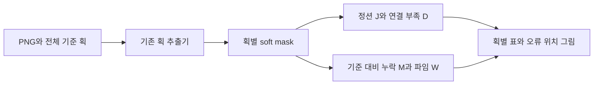
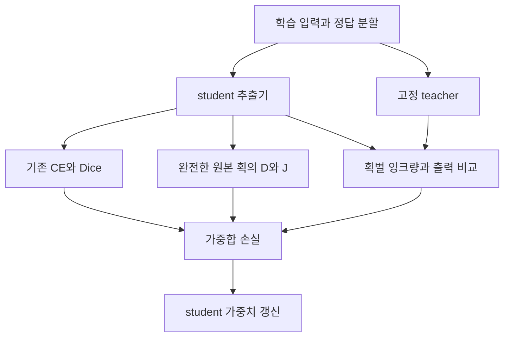

# 추출 획의 구조 진단 → 추출기 개선 과정

현재 구현은 진단기와 추가 학습용 손실 함수다. 기본 Colab 실행은 진단만 한다. 학습 코드 예시는 별도이며, 실제 체크포인트 재학습은 아직 실행하지 않았다.

## 1. 해결하려는 상황

정상 글자에서 세로획을 추출했는데 옆 가로획의 일부가 붙어 T자처럼 나오는 경우를 다룬다.

```text
목표 세로획      추출된 세로획
    │                │
    │                ├─
    │                │
```

이때 진단은 ‘이 추출 마스크에는 불필요한 분기가 있다’이다. 원본 글자가 잘못됐다는 판정은 하지 않는다. 다른 폰트라도 개별 획의 정션을 정상 스타일로 면제하지 않는다.

## 2. 입력과 기본 실행

사용자가 첫 셀에 CHECKPOINT, CSV_PATH, INPUT_FILES를 넣는다. CSV에서 입력 PNG, 기준 글자, 기준 획 목록을 읽는다. 누락된 획도 기준 목록에는 남겨 둔다. 입력 획의 정답 주석은 진단 실행에 필요하지 않다.

기존 추출기는 다음을 반환한다.

    p_k(x,y): 입력의 해당 픽셀이 k번 획에 속할 확률
    M_k(x,y) = I(x,y) * p_k(x,y): k번 획의 soft mask

검사는 M_k에서 한다. argmax/exclusive로 한 획을 강제 선택하지 않고, 획별 최댓값으로 밝기를 늘리지 않는다. 실제 누락으로 출력이 미약한 상태를 그대로 보존하기 위해서다.



## 3. 기준을 준비한다

기준 획을 skeleton으로 바꾼 뒤 중심선 픽셀을 순서대로 정렬한다. 일자·꺾인 선은 끝에서 끝 순서로, ㅇ은 고리 순서로 정렬한다. 이 과정은 고정 기준에 한 번 수행하므로 미분 가능할 필요가 없다.

중심선 주변에 누락 검사 영역, 연결 검사 시작/도착 영역, 둘 사이의 지역 통로를 만든다. 입력과 기준은 같은 좌표로 정렬돼 있어야 한다. 잘못 정렬된 기준을 쓰면 정상 획도 누락·분리로 보일 수 있다.

기준 자체가 비거나 여러 조각이거나 분기하면 오류를 낸다. 기준을 임의로 잘라 문제를 숨기지 않는다.

## 4. 정션 J를 측정한다

먼저 절대 잉크 기준 0.15/0.30/0.45/0.60/0.75에서 획의 존재 영역을 나눈다. 학습용으로는 sigmoid를 사용하는 부드러운 occupancy를 만든 뒤, 각 수준에서 soft skeleton S를 계산한다. 0은 정확히 0, 1은 정확히 1에 대응하도록 보정하며 획별 최댓값으로 나누지는 않는다. 이렇게 해야 잉크 강도 0.6인 T자를 1.8가닥으로 잘못 세지 않는다.

각 중심선 위치의 주변에 작은 고리를 두고 고리 위의 값을 순서대로 읽는다. 현재 구현의 고리는 정사각형 둘레다. 선과 배경 사이의 전환을 다음처럼 집계한다.

    b(x) = 0.5 * sum_i |q_(i+1) - q_i|

q_i는 주변 고리 위의 soft skeleton 값이다. 이진의 깨끗한 중심선에서는 b가 고리를 통과하는 가닥 수에 대응한다.

| 구조 | 기대 가닥 수 | 정션 조건 |
|---|---:|---|
| 끝점 | 1 | 없음 |
| 선의 중간·일반적인 꺾임 | 2 | 없음 |
| T/Y자 | 3 | 있음 |
| 십자 | 4 | 있음 |

3가닥 이상으로 갈라지는 반응을 측정하되, 기준 주변 본체에서 실제 마스크를 따라 도달할 수 있는 정도 H_k를 곱한다. 본체와 멀리 떨어진 작은 조각을 정션으로 세지 않기 위한 장치다.

    반응_t(x) = S_t(x) * H_t(x) * mean_r [b_(t,r)(x)-2-margin]_+^2
    J_k = sum_x max_t 반응_t(x) / 기준 중심선 길이

기본 고리 반경은 1, 2, 3픽셀이고 margin은 0이다. 작은 접합부 정션도 검사한다. 가지 길이가 일정 이상일 때만 벌주는 방식이나 폰트별 정션 차감은 적용하지 않았다.

이 J는 학습용 분기 반응이다. ‘정션이 정확히 몇 개’ 또는 ‘가지가 몇 픽셀’이라는 값은 아니다. 별도로 같은 절대 수준마다 일반 skeletonize를 적용해, 이산 중심선의 3가닥 이상 분기 영역을 찾고 빨간 원으로 표시한다. 이 검사는 미분되지 않으며 학습 손실에 넣지 않는다. hard 검사와 soft 근사는 일치가 보장되지 않으므로 함께 비교한다.

기본 화면은 원본 mask → 빨간 원을 표시한 hard skeleton → soft 반응의 3줄이다. soft 반응의 색 범위는 페이지 안에서 공유하며 원래처럼 무조건 0~1에 고정하지 않는다. 실제 peak와 J값을 함께 표시해 작은 양수가 0으로 반올림되거나 보이지 않던 문제를 줄였다.

## 5. 분리 D와 기준 대비 부족량 M/W를 측정한다

D는 조각 개수를 세지 않는다. 기준 경로의 시작 영역 A에서 도착 영역 B까지, 원본 soft mask의 잉크만 따라 이동할 수 있는지를 측정한다.

```text
정상 본체 + 외딴 조각: A━━━━━━━━B    ·   → 정상 연결 유지
실제 끊김:            A━━━━  ━━━B        → 연결 부족
```

지역 통로 안에서 R을 시작 영역의 잉크로 초기화하고 다음을 반복한다.

    R_next = min(원본 마스크, max_pool(R))

원본에 잉크가 없는 틈에서는 전파가 막힌다. 도착 영역에 전달된 강도 c를 양쪽 잉크 강도 u,v와 비교한다.

    D_AB = u*v * [ (min(u,v)-c) / max(min(u,v),eps) ]_+^2

여러 검사 쌍에서 평균한 값이 D다. ㅇ은 지역 구간마다 검사하므로 고리 반대편으로 돌아가 끊김을 숨기지 않도록 한다. 원본 마스크를 팽창시켜 틈을 메우지는 않는다.

M은 기준 중심선 주변에서 잉크가 부족한 정도다. W는 정상 기대 굵기 대비 국소 잉크량 부족의 보조 근사다. 기준에서부터 획이 빠졌으면 해당 획의 M을 측정할 수 없다. W는 정상 굵기 교정 전 기본 가중치가 0이다.

실제 원본에서 획이 삭제됐다면 M은 클 수 있지만, 비어 있는 추출 결과 자체는 올바를 수 있다. 그래서 M/W를 정션·분리와 합쳐 원본 품질 점수로 만들지 않는다.

## 6. 결과를 분리해서 출력한다

| 필드 | 계산 | 해석 |
|---|---|---|
| junction | J | 추출 획의 분기 반응 |
| branch_regions_max | 절대 수준별 분기 영역 수의 최댓값 | 빨간 원으로 확인할 분기 후보 |
| levels_with_branches | 분기를 발견한 절대 수준의 수 | 여러 수준에서 유지되는지 확인하는 참고값 |
| split | D | 기준 경로의 연결 부족 |
| missing / width | M / W | 기준 대비 부족량 |
| extraction_error | w_D D + w_J J | 추출 마스크의 구조 이상 지표 |
| reference_deficit | w_M M + w_W W | 별도 기준 비교 지표 |
| source_quality.assessed | False | 원본 글자 품질은 판정하지 않음 |

CSV 표, 기준/soft mask/오류 지도 PNG, 수치 지도 NPZ, 설정과 결과 JSON을 저장한다. 지도와 표를 보고 정션 위치가 실제 마스크의 분기와 맞는지 확인한다.

## 7. 추가 학습은 정답 분할을 중심에 둔다

진단은 기존 모델의 결과를 바꾸지 않는다. 추출 결과를 바꾸려면 별도의 추가 학습을 실행해야 한다. 현재는 그때 사용할 손실 함수를 구현한 상태다.

먼저 기존 추출기의 복사본 teacher를 고정한다. teacher는 추가 학습 동안 갱신하지 않고, 같은 입력에 대한 기존 획 배정과 잉크량을 제공한다. student만 갱신한다.



원본에서 완전한 획임을 확인한 채널만 topology_valid=True로 지정한다. 실제 누락/손상 또는 정상 여부가 불명확한 채널은 False다. 이 표시를 student의 예측 결과로 자동 결정하지 않는다. 표시가 모두 False면 기존 supervised 손실만 사용한다.

기본 학습 손실은 다음과 같다.

    L = L_CE + L_Dice + 0.001*L_flow
        + 0.05*L_structure
        + 0.2*L_mass_guard
        + 0.1*L_consistency

- 기존 CE/Dice: 주석된 픽셀의 정답 획 배정을 유지한다. 교차점 등 -1인 미주석 영역은 기존 방식대로 제외한다.
- structure: topology_valid 채널의 가중 D+J 평균이다. M/W는 넣지 않는다.
- mass_guard: teacher 대비 획별 잉크가 기본 15%보다 더 줄면 벌점을 준다. 획 전체 삭제로 정션을 피하는 것을 억제한다.
- consistency: student/teacher soft mask 차이의 제곱합을 teacher 잉크량으로 정규화한다. 다른 획으로 통째로 넘기는 변화를 억제한다.

보존 항은 기존 오류를 붙잡을 수도 있고, 같은 잉크량으로 잘못 재배정하는 모든 편법을 막지는 못한다. 따라서 정답 Dice와 J/D를 함께 확인한다. 현재 수치는 검증된 최적값이 아닌 초기값이며 첫 셀에서 조절한다.

## 8. 미분은 어디까지 이어지는가

student soft mask → pooling/min/max/차이/제곱/평균 → 학습 손실 → student 파라미터로 기울기를 전달한다. student 경로에는 detach, numpy, argmax, no_grad를 넣지 않는다. teacher와 고정 기준만 기울기를 끊는다.

min/max는 거의 모든 곳에서 부분 기울기를 전달하지만 동률·병목에서 희소하거나 불안정할 수 있다. 수렴 확인에 사용하는 값만 detach하고 실제 손실 그래프는 유지한다. 반복 상한 때문에 연결 전파가 끝나지 않으면 학습 함수가 거부한다.

현재 손실을 원본 글자의 품질 보상으로 역확산에 직접 연결하지 않는다. 원본 이미지와 추출기의 오류를 구별하는 검증이 선행돼야 한다.

## 9. 구현 확인과 다음 실험

25개 검사에서 합성 정상/외딴 잡음/누락/절단/짧은 분기/고리 절단, 약한 T자/진한 본체의 약한 가지/흐린 경계, student 기울기, teacher 기울기 차단, 채널 삭제 방지, 손상 입력 제외, 파일 저장을 확인했다. 실제 추가 학습의 개선 효과를 입증한 검사는 아니다. 첨부 스크린샷의 실제 값에 대한 재검증에는 원본 NPZ가 필요하다.

다음 실제 실험은 같은 정상 폰트 PNG 묶음에서 기존 모델과 추가 학습 모델을 비교한다. 미리 정한 별도 검증 묶음에서 정답 Dice가 유지되면서 J/D와 잘못된 분기 위치가 줄어드는지 확인한다. 단순히 J만 줄고 획이 사라지거나 다른 채널로 넘어가면 개선으로 인정하지 않는다.

관련 파일: [설정·API 상세](STROKE_STRUCTURE.md), [진단 구현](../../stroke_model/stroke_structure.py), [학습 손실 구현](../../stroke_model/extraction_training.py).
